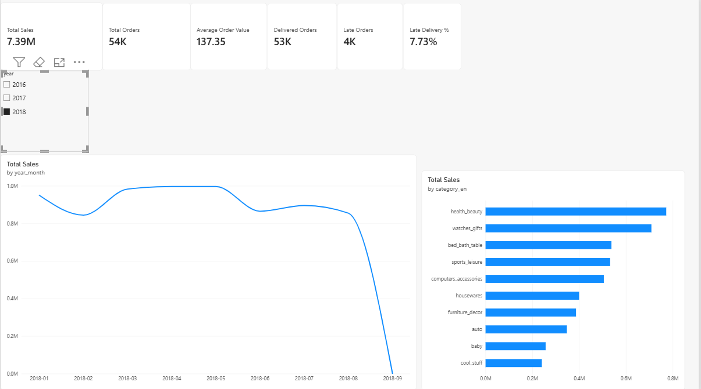
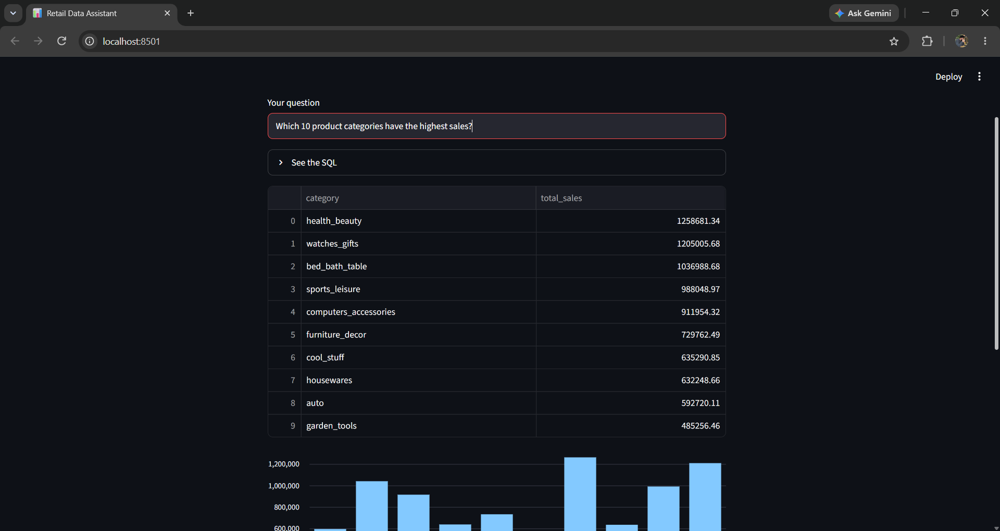

# Retail Analytics & Data Governance Platform

An end-to-end analytics project on the Olist Brazilian e-commerce dataset (about 100k orders, 2016-2018): raw CSVs → Python loader → PostgreSQL → star schema → Power BI dashboard.

## Tools
Python (pandas, SQLAlchemy), PostgreSQL, Google BigQuery, SQL, Power BI (DAX, Power Query), Excel, Git

## Architecture
raw CSVs → `raw` schema (PostgreSQL) → `clean` schema (star schema) → Power BI

The clean star schema is also loaded into **Google BigQuery** (`olist_clean` dataset). The tables are exported with `src/export_clean.py`, loaded with explicit schemas, and all 249,000+ rows were checked against PostgreSQL.

**Star schema:** `fact_order_items` (112,650 rows) with `dim_customer`, `dim_product`, `dim_seller` and `dim_date`.

**Star schema:** `fact_order_items` (112,650 rows) with `dim_customer`, `dim_product`, `dim_seller` and `dim_date`.
The clean tables are exported with `src/export_clean.py` and loaded into BigQuery with explicit schemas, and all 249,000+ rows were checked against PostgreSQL.

**Star schema:** `fact_order_items` (112,650 rows) with `dim_customer`, `dim_product`, `dim_seller` and `dim_date`.

## Dashboard

## Key findings
- Total sales: 13.59M BRL across 99,441 orders.
- About 96.7% of orders contain a single item.
- Sellers are concentrated in São Paulo state, which accounts for about 64% of sales.
- Only about 3% of orders come from repeat customers.
- Health & beauty is the top-selling category (about 1.26M BRL).

## Business insights

| Question | Finding | Recommendation |
|---|---|---|
| Do late deliveries hurt customer satisfaction? | Late orders average 2.27 stars vs 4.29 for on-time orders. 62.4% of late orders get a 1-2 star review, vs 9.3% of on-time orders. Late orders are about 7% of deliveries but produce about a third of all bad reviews. | Improve delivery estimates and carrier performance. If late orders were reviewed like on-time ones, there would be roughly 3,400 fewer bad reviews (illustrative estimate). |
| How often do customers return? | Only about 3% of orders come from repeat customers. | Test loyalty or re-engagement offers. |
| How big are baskets? | 96.7% of orders contain a single item. | Try bundles or "customers also bought" suggestions. |
| Where are sellers concentrated? | About 64% of seller sales come from São Paulo state. | Recruit sellers in other regions to reduce dependence on one area. |
| Which categories lose most to shipping? | Freight adds 16.6% to item prices on average, but 29.1% for electronics (about 1.75 times the average). Cheap items (electronics, food, telephony) pay a high share because prices are low; bulky furniture pays the most per delivery (about R$40 for office furniture). | Use free-shipping thresholds or bundles for cheap items; place sellers or stock closer to customers for bulky items. |
| Which categories bring customers back? | Only 3.1% of customers place a second order. Among categories, home appliances (10.7%), fashion bags & accessories (9.0%) and furniture decor (7.3%) have the highest share of returning customers. Category rates are biased upward, so they're compared with each other, not with the overall rate. | Use these categories for first-purchase offers and follow-up emails, and test whether that raises repeat buying. |

**Note:** these are insights from a public 2016-2018 dataset. They show strong associations, not proven causes, and the money estimates are illustrative.
## AI Data Assistant (natural language → SQL)

Ask a question in plain English and get the answer from the database, with the SQL and a plain-English explanation.

**How it works:** the question and the table schema are sent to a Gemini model with business rules → the model writes a SQL query → the query is checked and run on PostgreSQL → the result is shown as a table and chart → the model explains the answer.

**Safety (three layers):**
- The model is instructed to write SELECT queries only.
- `is_safe()` blocks any query that is not a SELECT.
- Queries run as a read-only database user (`ai_reader`) with SELECT access to the clean schema only.

**Business rules:** the first version counted freight as sales and gave a 2018 total of 8.64M instead of 7.39M. Adding business rules (sales = price only, currency R$, customers counted by `customer_unique_id`, partial years flagged, customer vs seller state) fixed this. The model also states any assumption it makes.

**Testing:** 10 questions with known answers (`src/test_questions.py`). Score: **10/10**.

**Run it:** `python -m streamlit run src/app.py`
## Data quality issues found
- 8 orders marked "delivered" have no delivery date.
- 775 orders have no items (mostly unavailable or canceled).
- 610 products have no category.
- Zip codes lost their leading zeros on import (fixed in the clean layer).
- The dataset is incomplete at the end of 2018, so the sales drop in the last month is not a real trend.

See `docs/data_quality_log.md` for details.

## Project status
- [x] Raw load, clean layer, star schema, integrity checks
- [x] Power BI dashboard with DAX measures (sales, AOV, late delivery %, YoY)
- [x] Data dictionary for all five clean tables (`docs/data_dictionary.md`)
- [x] Data quality log (`docs/data_quality_log.md`)
- [x] SQL analysis: window functions and business insights (`sql/`)
- [x] Star schema migrated to Google BigQuery
- [x] AI assistant: natural language → SQL with safety rules, business rules and testing (10/10)
- [ ] Lineage diagram